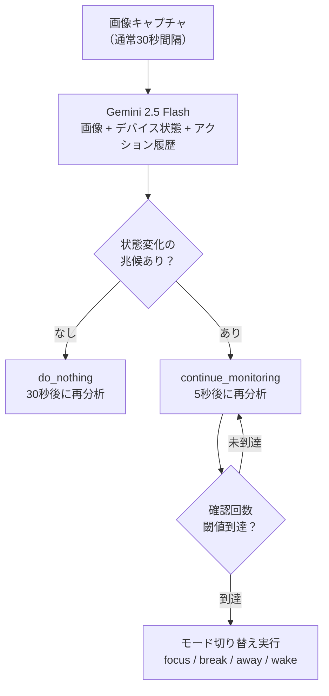
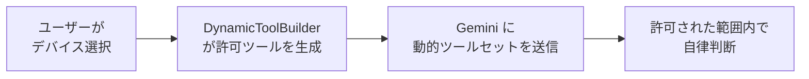
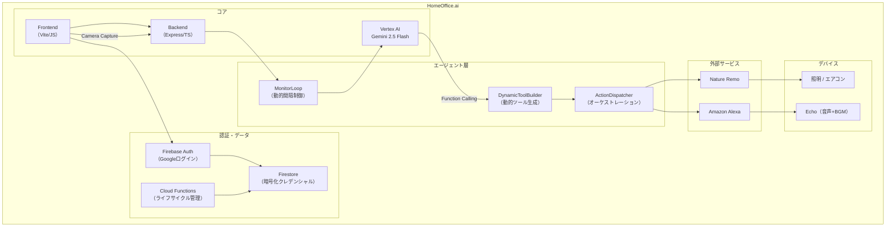

# HomeOffice.ai

> **住環境に介入するAIエージェント** — Webカメラでユーザー状態を認識し、照明・空調・音楽を自律制御して集中環境を維持します。

## デモ動画

[](https://youtu.be/EOxVVIZ_OTg)

🔗 **デプロイURL**: https://homeoffice-ai-675363481262.asia-northeast1.run.app

## 課題と解決策

リモートワークは制度として普及したが、自宅は「働くために設計された空間」ではない。照明・空調・音環境がオフィスと異なるため集中が続かず、環境調整はユーザーの手動操作に依存している。

**HomeOffice.ai** は、Webカメラ映像からユーザー状態（集中・休憩・居眠り・離席）をリアルタイム判定し、照明・エアコン・BGM・音声を自律的に連携制御する**環境制御型AIエージェント**です。従来のスマートホームが「ユーザーが命令 → デバイスが動く」受動型であるのに対し、本プロダクトは「環境がユーザー状態を理解し、自律的に最適化する」能動型アーキテクチャを採用しています。

## 主要機能

### 1. 段階的確認ループによる自律判断

1回の画像分析で即断せず、状態変化の兆候を検出すると `continue_monitoring`（5秒間隔）で**繰り返し確認**し、確信を得てからモード切り替えを実行します。「一瞬目を閉じた」と「本当に寝ている」を区別し、誤検知による過剰介入を防止します。



### 2. 4モードオーケストレーション制御

Geminiが1つのFunction Callingツール（例: `break_mode`）を選択すると、バックエンドが**照明→音声→BGMを時間差で順次実行**。単一デバイスの制御ではなく、空間全体を一括で遷移させるオーケストレーション設計です。

| モード | トリガー | 制御内容 |
|--------|---------|---------|
| `focus_mode` | 作業開始・復帰 | 全灯 + 集中BGM + アナウンス |
| `break_mode` | 休憩検出 | 安らぎ照明 + リラックスBGM |
| `away_mode` | 離席検出 | 全デバイスOFF（節電） |
| `wake_mode` | 居眠り検出 | 仮眠2分 → 全灯 + 覚醒BGM（2フェーズ制御） |

### 3. 動的ツール生成

ユーザーがセッション開始時に許可したデバイスに基づき、Geminiに渡すFunction Callingツールを**リクエスト毎に動的生成**。AIは許可された範囲内でのみ自律判断を行い、ユーザーの意図に反した制御を構造的に防止します。



### 4. マルチユーザー認証 + セキュアIoT連携

Firebase Authentication（Googleログイン）でユーザーを認証し、IoTクレデンシャルを**AES-256-GCM暗号化**してFirestoreに保存。Alexa認証はブラウザ内リバースプロキシ方式でCookieを自動取得します。アカウント削除時にはCloud Functionsでデータを自動クリーンアップ。ゲストモードも用意されており、認証なしでも体験可能です。

## システムアーキテクチャ



## 技術スタック

| レイヤー | 技術 | 詳細 |
|---------|------|------|
| **AI/LLM** | Vertex AI Gemini 2.5 Flash | VLM画像分析・Function Calling |
| **フロントエンド** | JavaScript (ES6) + Vite | MediaDevices API カメラ連携・Web Speech API |
| **バックエンド** | TypeScript (strict) + Express.js | REST API・オーケストレーション制御 |
| **認証** | Firebase Authentication | Googleログイン + ゲストモード |
| **データベース** | Cloud Firestore | ユーザー別IoTクレデンシャル（AES-256-GCM暗号化） |
| **IoT連携（照明/AC）** | Nature Remo Cloud API | 照明12モード・エアコン温度制御 |
| **IoT連携（音声）** | alexa-remote2 | 音声読み上げ・BGM・ルーティン・天気/ニュース |
| **サーバーレス** | Firebase Cloud Functions | 認証ライフサイクル管理 |
| **インフラ** | Google Cloud Run | Docker マルチステージビルド |

## Agentic AI の特徴

| # | 特徴 | 説明 |
|---|------|------|
| 1 | **段階的確認による慎重な自律判断** | `continue_monitoring` による複数回の再分析で確信を得てから行動。単純なif-elseでも1回の即断でもない、エージェント固有の判断戦略 |
| 2 | **オーケストレーション型の複合制御** | 1つのFunction Calling選択で照明→音声→BGMを時間差順次実行。空間全体を一括で遷移させる設計 |
| 3 | **動的ツール生成とセッションスコープ権限** | 許可デバイスに基づきFunction Callingツールをリクエスト毎に動的生成。ユーザーの意図に反した制御を構造的に防止 |
| 4 | **物理的介入による行動変容** | デジタル通知ではなく照明・温度・音楽・音声という物理的介入で行動変容を促進。`wake_mode` では仮眠→覚醒の2フェーズ時間制御を自動実行 |
| 5 | **プライバシー配慮** | カメラ映像はVertex AI Geminiで分析後に即削除。Vertex AI経由のためモデル学習に使用されず、映像データはサーバーに一切保存されない |

## セットアップ

<details>
<summary>開発環境の構築手順</summary>

### 前提条件

- **Node.js 20+**
- **Google Cloud CLI** -- `gcloud auth application-default login` で認証済みであること
- **Nature Remo API トークン** -- [home.nature.global](https://home.nature.global/) から取得
- **Alexa Cookie**（任意） -- Amazon Echo の音声制御を使用する場合に必要

### 1. リポジトリのクローン

```bash
git clone <repository-url>
cd HomeOfficeAI
```

### 2. 依存パッケージのインストール

```bash
# フロントエンド
cd frontend && npm install

# バックエンド API
cd backend && npm install

# バックエンドパッケージ（必要に応じて）
cd backend/packages/nature-remo && npm install
cd backend/packages/iot-ai-agent-loop && npm install
cd backend/packages/alexa-remote2 && npm install
```

### 3. 環境変数の設定

```bash
# テンプレートをコピーして編集する
cp backend/.env.sample backend/.env
```

`.env` ファイルを開き、以下の値を設定します。

| 変数 | 説明 |
|------|------|
| `GOOGLE_CLOUD_PROJECT` | Google Cloud プロジェクト ID |
| `NATURE_REMO_TOKEN` | Nature Remo API トークン |
| `ALEXA_COOKIE_FILE_PATH` | Alexa Cookie ファイルパス（任意） |

### 4. 開発サーバーの起動

```bash
# フロントエンド（ポート 5173）
cd frontend && npm run dev

# バックエンド API（ポート 3001、ホットリロード付き）
cd backend && npm run dev
```

</details>
